# Firewatch Home for webOS

[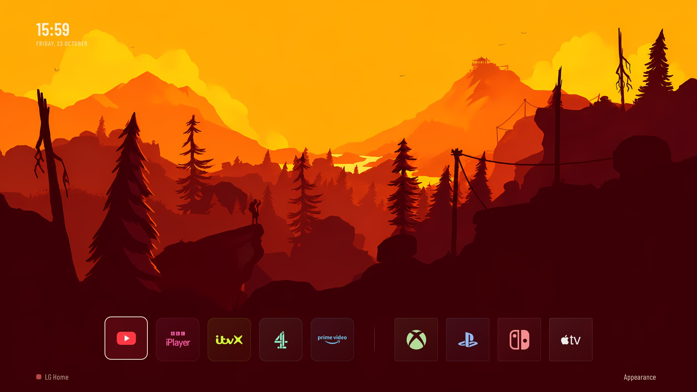](docs/images/valley-evening.jpg)

*Valley · Evening*

An unofficial Firewatch-themed home screen for LG webOS TVs: app shortcuts, HDMI inputs, a clock and animated landscapes that change through the day. Not affiliated with or endorsed by Campo Santo.

**[Browse all 42 wallpapers →](docs/GALLERY.md)**

## Four favourites

| Valley · Morning | Snowy Valley · Dusk |
| --- | --- |
| [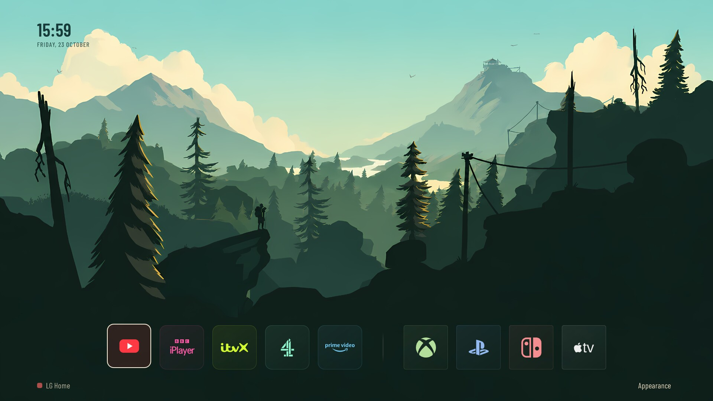](docs/images/valley-morning.jpg) | [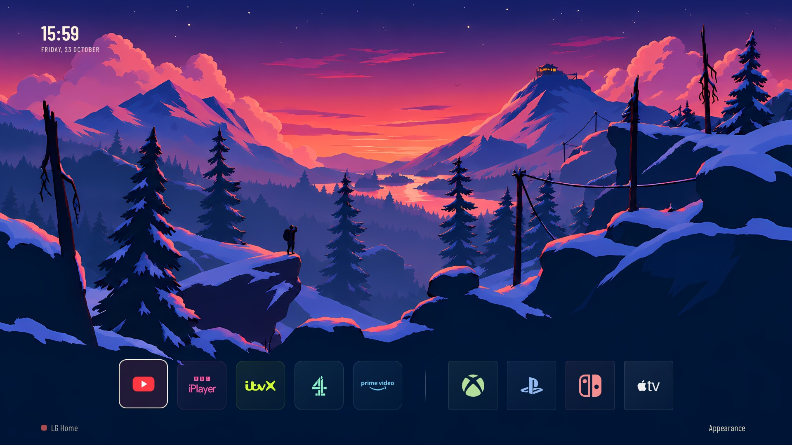](docs/images/snowy-valley-dusk.jpg) |
| **Lookout · Afternoon** | **Lookout Close-up · Noon** |
| [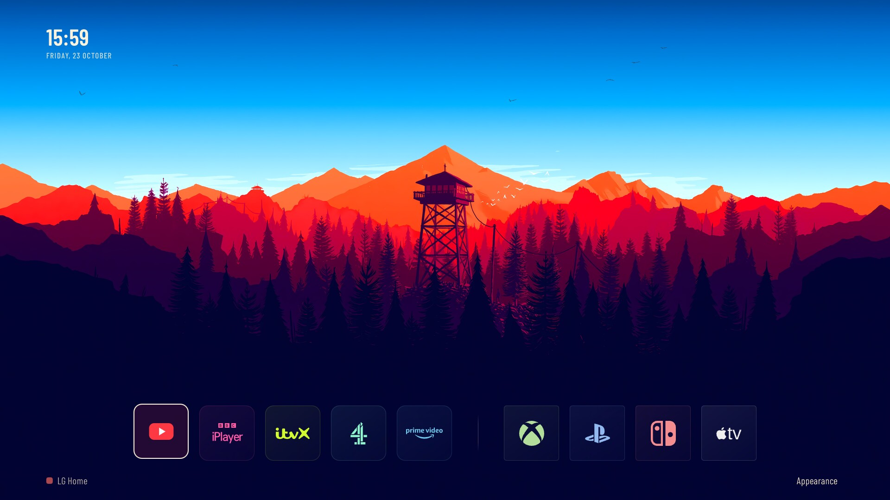](docs/images/lookout-afternoon.jpg) | [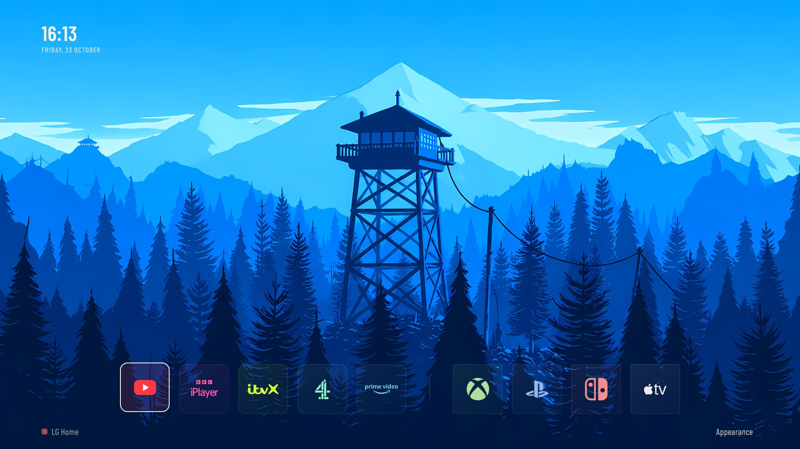](docs/images/lookout-close-noon.jpg) |

Click any image for the full **1920 × 1080** TV capture.

## From dawn to night

Each panorama combines seven vertical slices of the same scene, captured directly on the TV. The clock, app buttons and controls are included in the captures.

**Left → right: Dawn · Morning · Noon · Afternoon · Evening · Dusk · Night**

**Valley**

[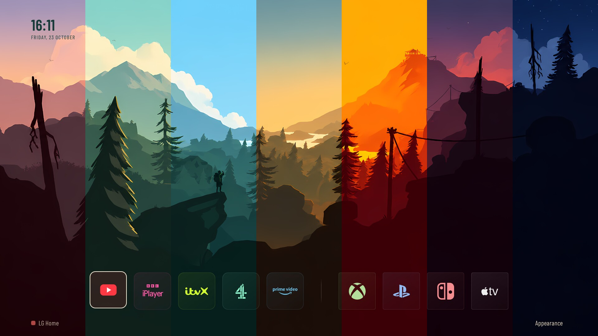](docs/images/valley-day-to-night.png)

**Snowy Valley**

[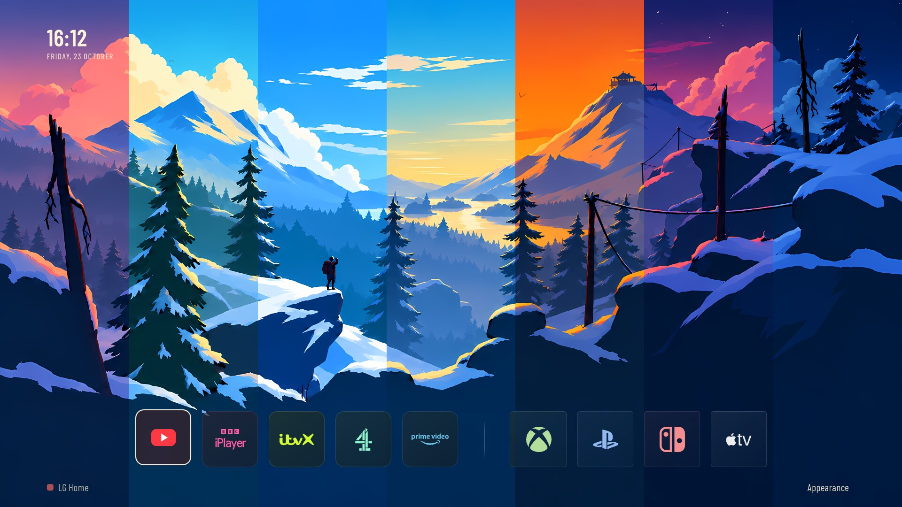](docs/images/snowy-valley-day-to-night.png)

**Lookout**

[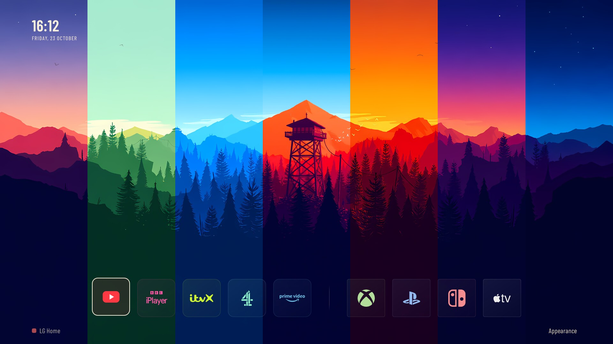](docs/images/lookout-day-to-night.png)

**Snowy Lookout**

[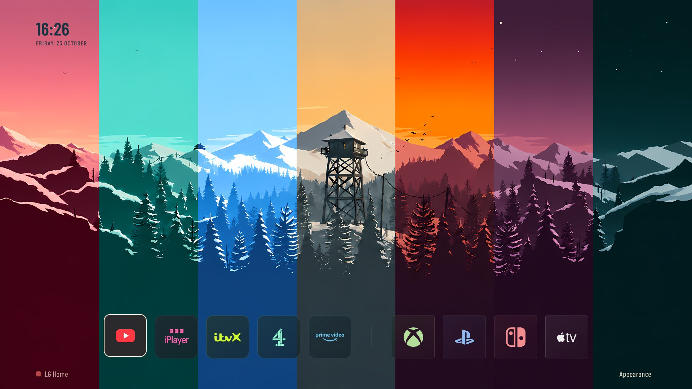](docs/images/snowy-lookout-day-to-night.png)

**Lookout Close-up**

[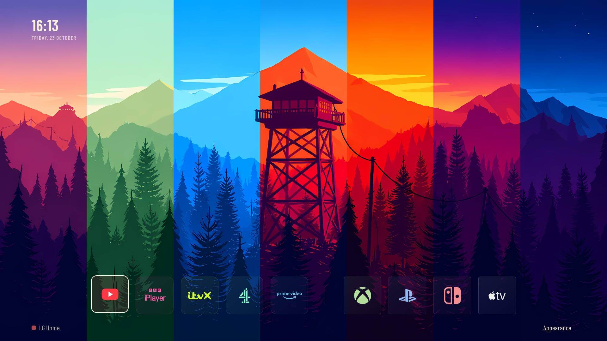](docs/images/lookout-close-day-to-night.png)

## Community setup candidate

**Buildable developer preview; fresh-TV validation is still pending.** This private community branch adds a remote-friendly setup flow without changing the owner's installed TV.

Choose your installed apps, reorder them, name and arrange HDMI inputs, and save from the remote. The original Appearance controls and artwork remain. No source edits or AI subscription are needed to use the setup panel.

[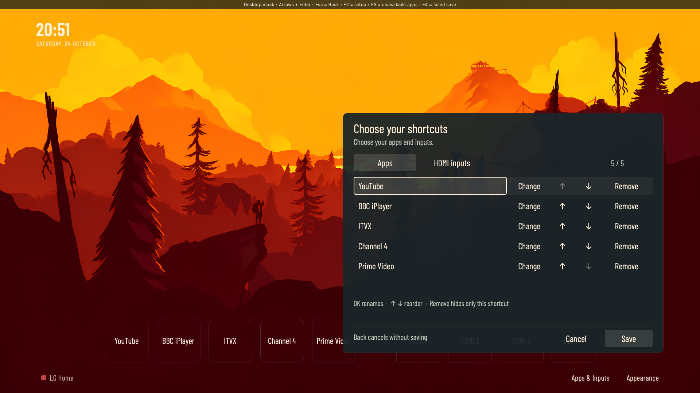](docs/images/community-setup.png)

*Desktop mock of the real setup controls, using a static wallpaper and simulated apps—not a TV capture or performance test.*

- **[Try the desktop preview](preview/README.md)** — no TV connection; arrows, Enter and Escape work like the remote.
- **[Build and install the standalone candidate](docs/GETTING_STARTED.md)** — pinned build, checksummed package and dry-run installer.
- **[Customise apps, HDMI inputs and clock](docs/CUSTOMIZATION.md)** — on-screen setup or a validated JSON configuration.
- [Build details](docs/BUILD.md) · [Test record](docs/TESTING.md) · [Portability and remaining work](docs/PORTABILITY.md) · [Recovery](docs/RECOVERY.md)
- [Optional prompts for Codex or Claude](docs/AI_ASSISTED_SETUP.md) · [Ideas studied from CleanYourTV and Slopbro](docs/UPSTREAM_IDEAS.md)

## Included

- Native QML/JavaScript renderer and a small, reproducibly compiled ARM launcher.
- Valley and Lookout, Autumn and Winter, including Lookout close-up: 42 wallpapers and seven times of day.
- Floating Cards Appearance, separate Auto and Motion controls; no Ember.
- Apps & Inputs editor with discovered-app selection, rename, reorder, hide, Save and Cancel.
- Up to five apps and four HDMI shortcuts; readable labels when a logo is unavailable.
- Configurable system/UTC/London clock and 12/24-hour format; matching automatic lighting.
- Back dismisses panels. Red and an on-screen action request LG Home while this app is active.
- Original app icons, Barlow fonts with OFL notice, asset checks and desktop/mock tests.

The package retains the existing Minimal Home app ID. The candidate installer refuses an existing installation. Default-Home/startup takeover and screensaver integration are **not** included in the standalone package. See the [release checklist](RELEASE.md).

## Hardware and speed

The development TV is an LG OLED48C24LA, webOS 24 / 9.2.2-61, firmware 23.25.55. The owner reported approximately five seconds from Power to forest with Quick Start+ off after the startup fixes. This is not a guarantee for other TVs or every power state. Native LG modules and optional rooted integration require explicit compatibility handling.

## Layout

- `src/native/`: current QML, shaders, fonts and approved theme files.
- `src/launcher.c`: native entry point; `tools/build.mjs` builds and packages it.
- `config/default.json`, `tools/config.mjs`, `tests/`: runtime configuration contract and offline tests.
- `themes/inventory.json`: exact image paths, dimensions, sizes, hashes and rights status.
- `SOURCE-MANIFEST.json`: community source/font hashes.
- `preview/`: desktop setup mock and navigation tests.
- `tools/install_app.py`: dry-run/read-only/app-only candidate installation.
- `docs/`: architecture, customization, artwork and recovery requirements.

## Local checks

Node.js 20 or newer, no external dependencies:

```sh
node --test tests/*.test.mjs
node tools/config.mjs config/default.json
```

These commands do not contact or modify a TV. No public installation command is supplied until the build, compatibility and rollback paths are ready.

## Licences and fan-project notice

**Firewatch Home is an unofficial, non-commercial fan project.**

I do not own Firewatch, its original artwork, characters, names or logos, or any other third-party artwork or trademarks included or shown here. All rights to those materials belong to their respective owners. Original Firewatch landscape artwork is credited to **Campo Santo and Olly Moss**. This project is not affiliated with, sponsored by or endorsed by Campo Santo or the other rights holders.

Recolouring, seasonal adaptations and AI upscaling do not transfer ownership of the underlying artwork. This fan-project notice does not grant a licence to use or redistribute third-party materials; their existing rights and licence terms still apply.

Credits, sources and adaptations are documented in [ARTWORK.md](docs/ARTWORK.md). Artwork redistribution permission remains unresolved. No project-wide licence has yet been selected for the original app code; any future code licence will exclude third-party artwork and trademarks. Bundled third-party components, including the Barlow font, retain their own licence notices.
