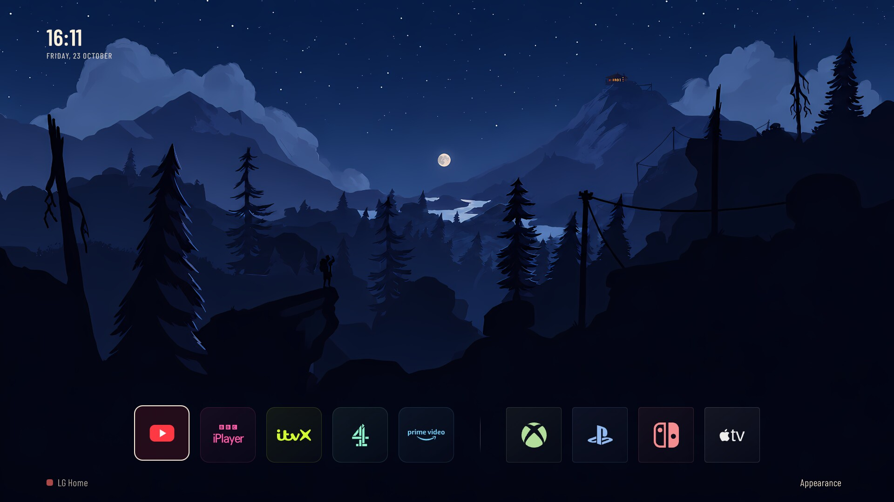
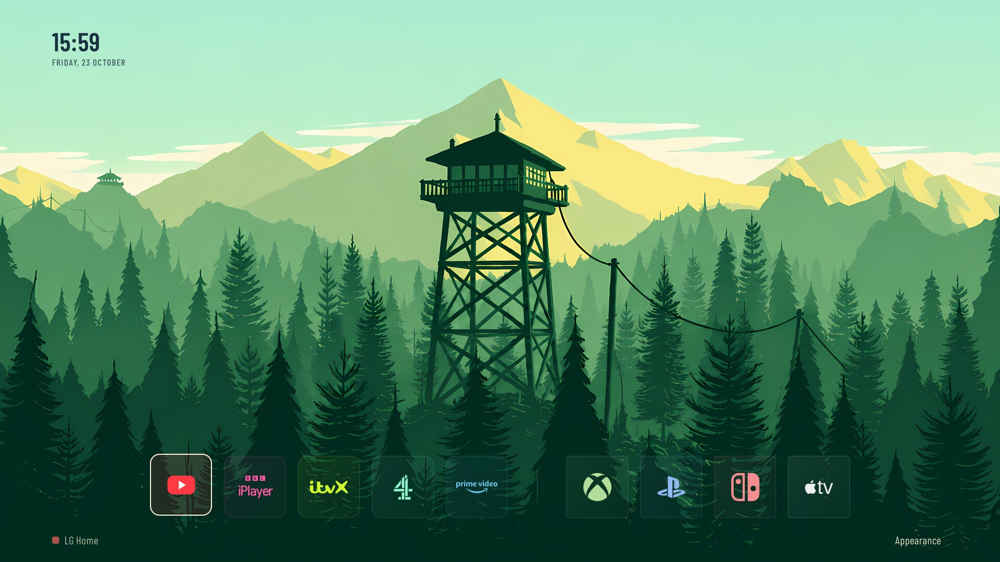

# Firewatch Home for webOS

[](docs/images/valley-evening.jpg)

*Valley · Evening*

An unofficial Firewatch-themed home screen for LG webOS TVs: app shortcuts, HDMI inputs, a clock and animated landscapes that change through the day. Not affiliated with or endorsed by Campo Santo.

## Four favourites

| Valley · Night | Snowy Valley · Dusk |
| --- | --- |
| [](docs/images/valley-night.jpg) | [](docs/images/snowy-valley-dusk.jpg) |
| **Lookout · Afternoon** | **Lookout Close-up · Morning** |
| [](docs/images/lookout-afternoon.jpg) | [](docs/images/lookout-close-morning.jpg) |

Click any image for the full **1920 × 1080** TV capture.

## From dawn to night

Each panorama combines seven vertical slices of the same scene, captured directly on the TV. The clock, app buttons and controls are included in the captures.

**Left → right: Dawn · Morning · Noon · Afternoon · Evening · Dusk · Night**

**Valley**

[](docs/images/valley-day-to-night.png)

**Snowy Valley**

[](docs/images/snowy-valley-day-to-night.png)

**Lookout**

[](docs/images/lookout-day-to-night.png)

**Snowy Lookout**

[](docs/images/snowy-lookout-day-to-night.png)

**Lookout Close-up**

[](docs/images/lookout-close-day-to-night.png)

## Development status

**Private development repository, not yet an installable public release.** Repository: [josephkimberley/firewatch-home](https://github.com/josephkimberley/firewatch-home).

The intended experience is install, launch and enjoy the included themes, with automatic app discovery and easy app/HDMI customization. That setup flow is still being built. This is an independent QML app with a small C entry point; OpenLauncher was a comparison and integration reference.

## Included

- Current QML/JS/shader snapshot: native 3.0.7, `back-panel-v3`.
- Valley and Lookout, each in Autumn and Winter, with seven lighting periods.
- Dedicated Lookout close-up variants: 42 wallpapers in total, plus 28 small previews and Winter night compositing assets.
- Floating Cards Appearance menu, separate Auto toggle and Motion control; no Ember.
- Back closes Appearance only; Red opens LG Home through the optional rooted mapping, with a small on-screen hint.
- Barlow Condensed fonts with their OFL notice.
- Offline configuration validator/tests and release documentation.

Current source still uses fixed app/HDMI tiles and the existing Minimal Home package ID. The proposed JSON configuration is not connected yet. Logo assets, reproducible native build tooling and generic root integration remain outstanding. See [release checklist](RELEASE.md).

## Hardware and speed

The development TV is an LG OLED48C24LA, webOS 24 / 9.2.2-61, firmware 23.25.55. The owner reported approximately five seconds from Power to forest with Quick Start+ off after the startup fixes. This is not a guarantee for other TVs or every power state. Native LG modules and optional rooted integration require explicit compatibility handling.

## Layout

- `src/native/`: current QML, shaders, fonts and approved theme files.
- `src/launcher.c`: retained launcher source; reproducible current binary build still to be completed.
- `config/default.json`, `tools/config.mjs`, `tests/`: proposed portable app/HDMI configuration and offline tests.
- `themes/inventory.json`: exact image paths, dimensions, sizes, hashes and rights status.
- `SOURCE-MANIFEST.json`: source/font snapshot hashes.
- `docs/`: architecture, customization, artwork and recovery requirements.

## Local checks

Node.js 20 or newer, no external dependencies:

```sh
node --test tests/*.test.mjs
node tools/config.mjs config/default.json
```

These commands do not contact or modify a TV. No public installation command is supplied until the build, compatibility and rollback paths are ready.

## Artwork and licences

Approved Firewatch-derived images are included in this private repository at the project owner's request. Credits and adaptations are documented in [ARTWORK.md](docs/ARTWORK.md). Redistribution permission remains unresolved; the artwork is separate from any future app-code licence. No project-wide source licence has yet been selected. Third-party components retain their own notices.
